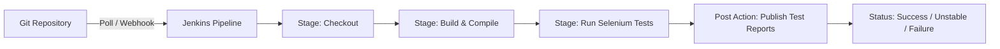

# Requirements

### Overview & Goals
The objective is to establish a robust continuous integration (CI) workflow to execute the Selenium UI Automation TestNG suite automatically within a Jenkins pipeline. The pipeline will build the project, run tests in parallel using the existing `testng.xml` suite, generate test reports, and provide clear build health status.

### Scope
- **In Scope**:
  - Step-by-step Jenkins environment prerequisites (JDK 17, Maven, Chrome/Firefox, Plugins).
  - Creation of a standardized declarative `Jenkinsfile` in the repository root.
  - Integration with Maven Surefire Plugin to execute `testng.xml`.
  - Configuration of post-build test report publishing (`JUnit` / `TestNG` results).
  - Jenkins Pipeline job creation and configuration steps.
- **Out of Scope**:
  - Modifying existing test assertion logic or application endpoints.
  - Setting up third-party cloud Selenium Grids (BrowserStack/SauceLabs), though the pipeline will remain extensible for it.

### User Stories
- As a QA/Automation Engineer, I want the Selenium UI test suite to run automatically in Jenkins upon code pushes or on demand, so that regressions are caught early in the development lifecycle.
- As a team member, I want to view test execution summaries and failure stack traces directly in the Jenkins UI, so that I can quickly diagnose test failures without downloading raw logs.

### Functional Requirements
- **Automated Execution**: The pipeline must pull the latest code, compile with Java 17, and execute tests via `mvn test`.
- **Headless & Environment Support**: Tests must run smoothly on CI agents without requiring a physical monitor.
- **Reporting**: Jenkins must parse the test results located at `target/surefire-reports` and present test counts, pass/fail ratios, and failure logs.
- **Pipeline Status**: The pipeline build status must accurately reflect the test run outcome (Success, Unstable, or Failure).

# Technical Design

### Current Implementation
- **Build Tool**: Maven with Java 17 (`pom.xml`).
- **Dependencies**: Selenium Java 4.51.0, TestNG 7.12.0.
- **Test Runner**: `maven-surefire-plugin` (version 3.5.2) configured to execute `testng.xml`.
- **Suite Configuration**: `testng.xml` configured with `parallel="methods"` and `thread-count="3"`.
- **Driver Setup**: `DriverFactory.java` supports Chrome and Firefox, reading `headless` and `browser` from `config.properties`.

### Pipeline Architecture Overview


### Proposed Jenkinsfile Design
A declarative `Jenkinsfile` placed at the root of the project:

```groovy
pipeline {
    agent any

    tools {
        jdk 'JDK17'
        maven 'Maven3'
    }

    options {
        timeout(time: 30, unit: 'MINUTES')
        buildDiscarder(logRotator(numToKeepStr: '15'))
        ansiColor('xterm')
    }

    environment {
        // Ensure headless execution for CI environment if needed
        CI = 'true'
    }

    stages {
        stage('Checkout') {
            steps {
                checkout scm
            }
        }

        stage('Compile') {
            steps {
                bat 'mvn clean test-compile' // Use 'sh' on Linux/macOS agents
            }
        }

        stage('Execute Selenium Tests') {
            steps {
                // Runs the TestNG suite configured in pom.xml / testng.xml
                bat 'mvn test' // Use 'sh' on Linux/macOS agents
            }
        }
    }

    post {
        always {
            // Publish JUnit/TestNG test results
            junit testResults: '**/target/surefire-reports/*.xml', allowEmptyResults: true
            
            // Archive TestNG HTML reports
            archiveArtifacts artifacts: 'target/surefire-reports/**', allowEmptyArchive: true
        }
        success {
            echo 'Selenium UI Automation Suite passed successfully!'
        }
        unstable {
            echo 'Some tests failed in the suite.'
        }
        failure {
            echo 'Build or test execution failed.'
        }
    }
}
```

### Key Decisions
1. **Declarative Pipeline**: Used Declarative syntax over Scripted pipeline for better maintainability, readability, built-in validation, and native support for post-actions and tools blocks.
2. **Standard Maven Test Phase**: Leveraging the existing `maven-surefire-plugin` configuration ensures the exact suite (`testng.xml`) and parallel thread settings are respected without duplicating configuration in Jenkins.
3. **Cross-Platform Scripting (bat / sh)**: Support both Windows nodes (using `bat`) and Linux nodes (using `sh` or `isUnix()` checks) depending on the Jenkins agent environment.
4. **JUnit Plugin for Test Reporting**: Jenkins natively parses Surefire XML files (`target/surefire-reports/*.xml`) via the JUnit step, providing built-in test result trends and failure details.

# Jenkins Pipeline Setup Guide

### Step-by-Step Jenkins Setup Instructions

#### Step 1: Install Required Jenkins Plugins
1. Open Jenkins and navigate to **Manage Jenkins** > **Plugins** (or **Manage Plugins**).
2. Go to the **Available plugins** tab.
3. Search for and install the following plugins (restart Jenkins if prompted):
   - **Git plugin**
   - **Pipeline**
   - **Maven Integration**
   - **JUnit Plugin** (for publishing test results)
   - **TestNG Results Plugin** (optional, for specialized TestNG reports)
   - **AnsiColor** (optional, for colored console logs)

---

#### Step 2: Configure Global Tools (JDK & Maven)
1. Navigate to **Manage Jenkins** > **Tools** (or **Global Tool Configuration**).
2. **JDK Setup**:
   - Under **JDK**, click **Add JDK**.
   - Set **Name**: `JDK17`.
   - Either select **Install automatically** (e.g., Adoptium OpenJDK 17) or specify the local `JAVA_HOME` path on the agent.
3. **Maven Setup**:
   - Under **Maven**, click **Add Maven**.
   - Set **Name**: `Maven3`.
   - Check **Install automatically** and select the latest Apache Maven 3.9.x version (or provide local `MAVEN_HOME`).
4. Click **Save** / **Apply**.

---

#### Step 3: Ensure Browser & Display Prerequisites on Agents
- **Browser Installation**: Ensure Google Chrome or Firefox is installed on the machine running the Jenkins agent.
- **Headless Mode**: For CI runners without GUI display, configure `headless=true` in `src/main/resources/config.properties` or pass headless flags to the browser options.
- **Driver Management**: Selenium 4.51.0 includes Selenium Manager which automatically downloads the matching ChromeDriver / GeckoDriver binaries at runtime. Ensure the agent has internet access.

---

#### Step 4: Create the Jenkins Pipeline Job
1. From the Jenkins dashboard, click **New Item**.
2. Enter a job name (e.g., `Selenium-UI-Automation-Pipeline`).
3. Select **Pipeline** and click **OK**.
4. In the Job Configuration page:
   - (Optional) Check **GitHub project** and enter the repository URL.
   - (Optional) Under **Build Triggers**, configure **Poll SCM** or **GitHub hook trigger for GITScm polling** for automated runs.
5. Scroll down to the **Pipeline** section:
   - Change **Definition** to **Pipeline script from SCM**.
   - Select **SCM**: **Git**.
   - Enter your **Repository URL** and select your **Credentials**.
   - Set **Branch Specifier** (e.g., `*/main` or `*/master`).
   - Set **Script Path** to `Jenkinsfile`.
6. Click **Save**.

---

#### Step 5: Add the `Jenkinsfile` to your Repository
Create a file named `Jenkinsfile` at the root of your project repository (as outlined in Technical Design), commit it, and push to your Git remote:
```bash
git add Jenkinsfile
git commit -m "Add Jenkinsfile for Selenium UI test pipeline"
git push origin main
```

---

#### Step 6: Trigger and Monitor the Pipeline
1. On the Jenkins job page, click **Build Now**.
2. Click on the active build number (e.g., `#1`) > **Console Output** to monitor live test execution.
3. Once completed, review:
   - **Test Result Trend**: View passed, failed, and skipped test counts.
   - **Pipeline Stage View**: Verify execution duration for each stage.
   - **Artifacts**: Download `surefire-reports` if archived.

# Testing

### Validation Approach
Verify that the pipeline triggers, executes tests reliably, and records test metrics accurately.

### Key Scenarios
1. **Fresh Build & Execution**:
   - Trigger the pipeline on a clean agent.
   - Verify JDK 17 and Maven 3 tools are properly resolved and loaded.
   - Verify `mvn test` triggers `testng.xml` and runs tests across the 3 parallel threads.
2. **Passing Test Suite**:
   - When all tests pass, the pipeline stage is marked Green, the build status is `SUCCESS`, and the JUnit report displays 100% pass rate.
3. **Failing Test Scenario**:
   - Introduce a failing assertion or simulated error.
   - Verify the pipeline completes the `post` block, marks the build as `UNSTABLE` or `FAILURE`, and renders the failed test name and stack trace in the Test Results dashboard.
4. **Report and Artifact Archiving**:
   - Check that `target/surefire-reports` XML files are processed by `junit` step.
   - Check that TestNG reports are attached as build artifacts.

### Edge Cases & Troubleshooting
- **Missing Display on Agent**: If browser fails with `SessionNotCreatedException` or display errors, verify `headless=true` is set.
- **Firewall / Driver Download**: If Selenium Manager cannot download drivers behind corporate proxy, pre-install drivers or configure proxy environment variables (`HTTP_PROXY`/`HTTPS_PROXY`) in the pipeline `environment` block.
- **OS Compatibility (Windows vs Linux Agents)**: Use conditional steps (`isUnix() ? sh 'mvn test' : bat 'mvn test'`) to support heterogeneous agent environments.

# Delivery Steps

###   Step 1: Create Declarative Jenkinsfile
Create a declarative `Jenkinsfile` in the project root to automate the build, test execution, and test reporting.

- Define a pipeline using `agent any` (or a specific label with Chrome/Firefox and Java 17 installed).
- Configure `tools` block for JDK 17 and Maven 3.x.
- Add checkout stage to fetch code from Git repository.
- Add build stage running `mvn clean compile`.
- Add test stage running `mvn test -DsuiteXmlFile=testng.xml`.
- Add `post` actions to publish JUnit / TestNG test reports from `target/surefire-reports/*.xml` and archive HTML artifacts.

###   Step 2: Configure Jenkins Environment and Plugins
Configure the Jenkins Controller/Agent environment with necessary dependencies and plugins.

- Install required Jenkins plugins: `Git Plugin`, `Pipeline`, `Maven Integration`, and `JUnit Plugin` / `TestNG Results Plugin`.
- Configure Global Tool Configuration in Jenkins (`Manage Jenkins` -> `Tools`) for JDK (Java 17) and Maven.
- Ensure browsers (Google Chrome / Firefox) and display drivers / headless support are available on the Jenkins agent.

###   Step 3: Create and Configure Jenkins Pipeline Job
Create and configure the Jenkins Pipeline job to run tests automatically or on schedule.

- Create a new item in Jenkins of type **Pipeline** (or **Multibranch Pipeline**).
- Point the pipeline definition to **Pipeline script from SCM** selecting Git and providing the repository URL and credentials.
- Set branch specifier (e.g., `*/main` or `*/master`) and specify Script Path as `Jenkinsfile`.
- Configure optional build triggers (e.g., GitHub webhook polling or cron schedule) and build parameters if dynamic browser selection is desired.

###   Step 4: Validate Pipeline Execution and Report Publishing
Trigger the Jenkins job and verify test execution, test report generation, and failure handling.

- Trigger a manual build via **Build Now**.
- Monitor the console output to verify browser initialization, parallel execution of TestNG tests, and test completion.
- Verify that test results are rendered in the Jenkins UI test result trend chart and test report view.